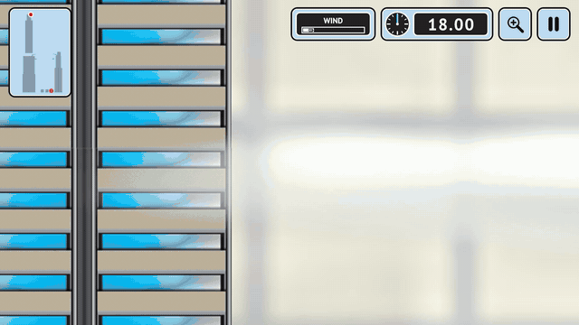
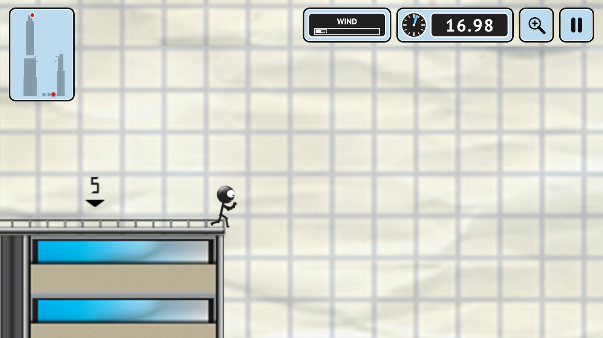
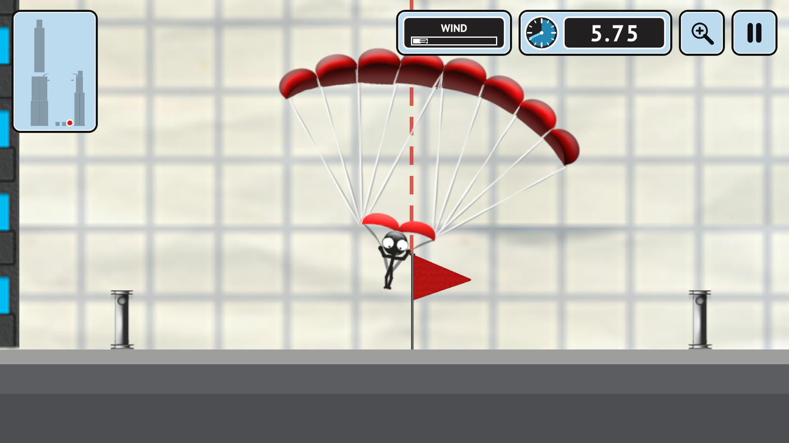
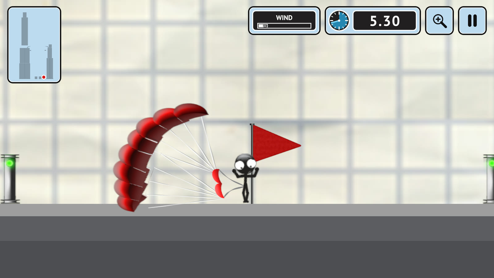
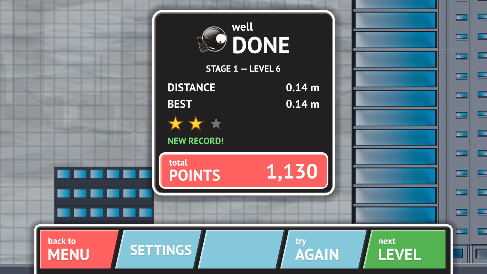
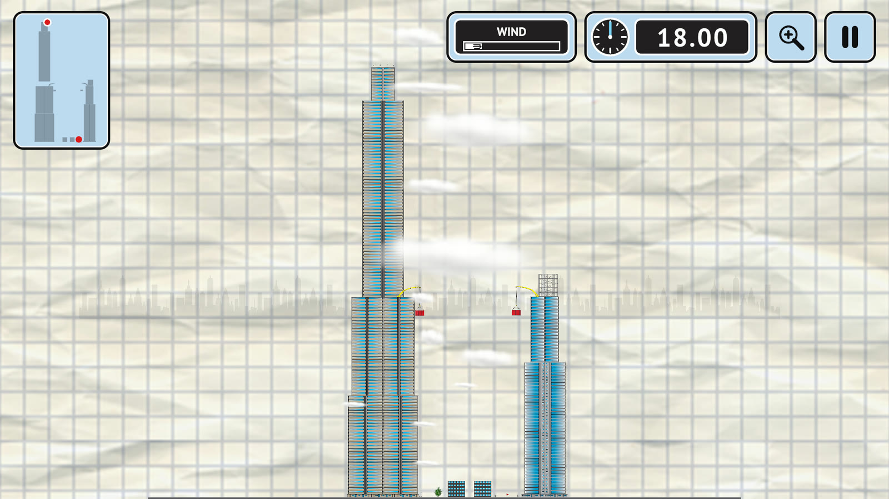
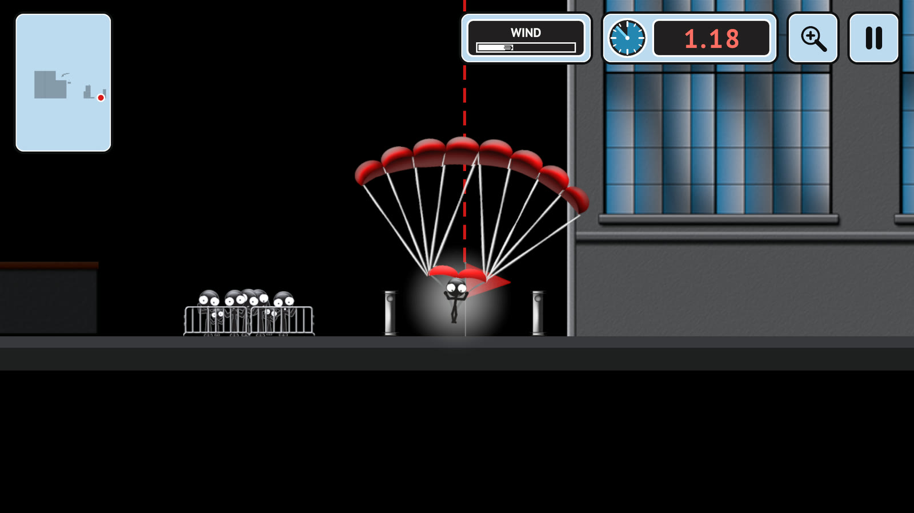
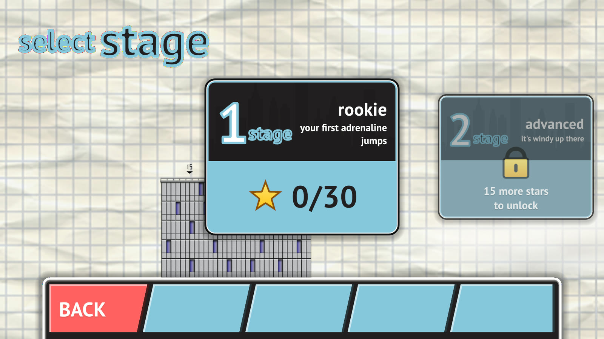
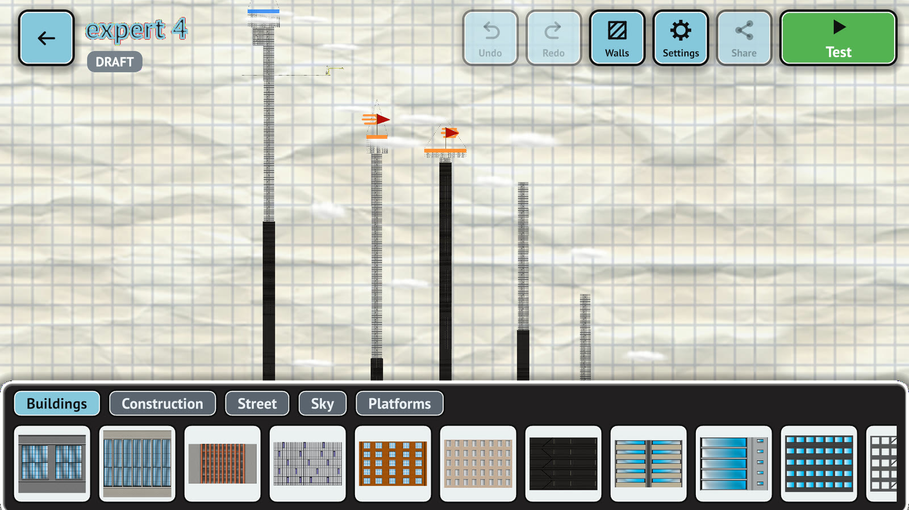

# Skyline Jumper

<p align="center">
  
</p>

<p align="center">
  <a href="https://github.com/fuad00/skyline-jumper/releases/latest"></a>
  
  
  
</p>

A 2D side-view base-jumping game for Android and iOS, made with Unity 6.

Walk back, take a run-up, jump off the roof, free-fall, open the parachute at the right moment and land as close to the flag as you can — before the time runs out. One-touch controls, landscape screen.

> **Status:** prototype, stage 1 — the core mechanics. The working title in code is `StickmanJumper`.

[Русская версия ниже ↓](#skyline-jumper-по-русски)

## Download

Get the files from the **[latest release](https://github.com/fuad00/skyline-jumper/releases/latest)**.

| Device | File | How to install |
|---|---|---|
| Android 8+ | `SkylineJumper-0.1.0.apk` | Open the file on the phone and allow installing apps from this source. |
| iPhone, iPad | `SkylineJumper-0.1.0-unsigned.ipa` | The file is not signed. Install it with [Sideloadly](https://sideloadly.io) or [AltStore](https://altstore.io) using your Apple ID; with a free Apple ID the app has to be re-signed every 7 days. |

## Screenshots

<table>
  <tr>
    <td width="50%"></td>
    <td width="50%"></td>
  </tr>
  <tr>
    <td align="center"><sub>Run-up: the marks show metres to the edge</sub></td>
    <td align="center"><sub>Under the canopy, right above the flag</sub></td>
  </tr>
  <tr>
    <td></td>
    <td></td>
  </tr>
  <tr>
    <td align="center"><sub>Soft landing — the signal lights turn green</sub></td>
    <td align="center"><sub>Distance to the flag, stars and points</sub></td>
  </tr>
  <tr>
    <td></td>
    <td></td>
  </tr>
  <tr>
    <td align="center"><sub>Every level starts with the whole route in view</sub></td>
    <td align="center"><sub>Night levels: only what is near you is lit</sub></td>
  </tr>
  <tr>
    <td></td>
    <td></td>
  </tr>
  <tr>
    <td align="center"><sub>9 stages, 90 levels</sub></td>
    <td align="center"><sub>Map editor: build, test, share as a text code</sub></td>
  </tr>
</table>

## Features

- **One-tap controls:** tap to walk back, tap to run, tap to jump, tap to open the parachute (a tap under the canopy cuts it away).
- **Flight physics:** run-up speed, jump, free fall with a speed limit, a parachute that brakes hard and drifts with the wind, soft landing only under the canopy. All numbers live in ScriptableObject configs (`src/Assets/_Game/Config`), no magic numbers in gameplay code.
- **Levels:** stages with stars, a level timer, wind, intermediate platforms (land on one and keep running), night levels, signal lights at the target, hints on the first levels.
- **Map editor:** build your own levels, test them, share them as a text code.
- **Menu demo:** an autopilot plays levels behind the main menu.
- **Languages:** Russian and English, switchable on the fly.

## Requirements

- Unity **6000.6.5f1** (Unity 6.6) with **Android Build Support**; **iOS Build Support** for iOS.
- Xcode 26+ for iOS builds.

## Getting started

1. Open the `src/` folder in Unity Hub.
2. Run **Stickman Jumper → Setup Project** — it creates configs, art, levels and the game scene.
3. Open `Assets/_Game/Scenes/Game.unity` and press Play.

The repository contains only original code and art generated in code. The original game's assets used by the prototype are kept out of git (`reference/`, `src/Assets/_ThirdPartyPlaceholder/`, see `.gitignore`); without them the game falls back to its own simple levels and stick figure.

## Command line

Unity CLI path on macOS: `/Applications/Unity/Hub/Editor/6000.6.5f1/Unity.app/Contents/MacOS/Unity`.

| Task | Command |
|---|---|
| Set up the project | `Unity -batchmode -quit -projectPath src -executeMethod StickmanJumper.EditorTools.ProjectSetup.Run` |
| Tests (EditMode) | `Unity -batchmode -projectPath src -runTests -testPlatform EditMode -testCategory "!ReleaseGuard"` |
| Auto-play smoke test with screenshots | `Unity -batchmode -projectPath src -executeMethod StickmanJumper.EditorTools.SmokeTest.Run -smokeOut DIR` |
| Release: APK + unsigned IPA → `Builds/Release/` | `scripts/build-release.sh` |
| Screenshots and GIF for this page → `docs/media/` | `scripts/readme-media.sh` (needs ffmpeg) |
| Internal Android test APK | `Unity -batchmode -quit -projectPath src -buildTarget Android -executeMethod StickmanJumper.EditorTools.BuildTools.BuildAndroidTest` |
| Internal iOS simulator build | `Unity -batchmode -quit -projectPath src -buildTarget iOS -executeMethod StickmanJumper.EditorTools.BuildTools.BuildIosSimulatorTest`, then `xcodebuild` (see `CLAUDE.md`) |

Builds go to `Builds/` (ignored by git).

## Project layout

```
src/Assets/_Game/
  Scripts/Gameplay/      rules as plain C# classes: JumpSession, FlightModel, LandingJudge, Sweep, Scoring, Autopilot
  Scripts/Presentation/  what you see: level, stickman, canopy, camera
  Scripts/UI/            UI Toolkit screens and HUD
  Scripts/Maps/          map editor: data, share codes, storage
  Scripts/GameRoot.cs    glue between rules, view, UI and audio
  Config/                ScriptableObject configs with all the numbers
  Editor/                project setup, importers, build tools, smoke test, README media
src/Assets/Tests/        EditMode tests (physics, jump session, levels, maps, save, languages)
scripts/                 release builds and README media
```

## License and credits

All rights reserved. Fonts: PT Sans (SIL Open Font License, see `src/Assets/_Game/Fonts/OFL-PTSans.txt`).

The game art in the release builds, the screenshots and the GIF comes from the original game this prototype is based on and is used with its authors' permission. It is not part of this repository.

---

# Skyline Jumper по-русски

2D-бейсджампинг с видом сбоку для Android и iOS на Unity 6.

Отойди, разбегись, прыгни с крыши, лети, вовремя раскрой парашют и сядь как можно ближе к флажку, пока не вышло время. Управление одним касанием, горизонтальный экран.

> **Статус:** прототип, этап 1 — основные механики. Рабочее название в коде — `StickmanJumper`.

Скриншоты и GIF — в начале страницы.

## Скачать

Файлы — в **[последнем релизе](https://github.com/fuad00/skyline-jumper/releases/latest)**.

| Устройство | Файл | Как установить |
|---|---|---|
| Android 8+ | `SkylineJumper-0.1.0.apk` | Открыть файл на телефоне и разрешить установку из этого источника. |
| iPhone, iPad | `SkylineJumper-0.1.0-unsigned.ipa` | Файл не подписан. Ставится через [Sideloadly](https://sideloadly.io) или [AltStore](https://altstore.io) своим Apple ID; с бесплатным Apple ID приложение нужно переподписывать раз в 7 дней. |

## Что есть

- **Управление тапами:** отойти, разбежаться, прыгнуть, раскрыть парашют (тап под куполом отрывает его).
- **Физика полёта:** разгон на разбеге, прыжок, падение с пределом скорости, парашют сильно тормозит и сносится ветром, сесть можно только под куполом. Все числа — в настройках ScriptableObject (`src/Assets/_Game/Config`), в коде правил чисел нет.
- **Уровни:** этапы со звёздами, таймер, ветер, промежуточные платформы (сел — и бежишь дальше), ночные уровни, сигнальные огни у цели, подсказки на первых уровнях.
- **Конструктор карт:** свои уровни, проверка прохождением, обмен текстовым кодом.
- **Заставка в меню:** автопилот сам прыгает за главным меню.
- **Языки:** русский и английский, переключаются на ходу.

## Что нужно

- Unity **6000.6.5f1** (Unity 6.6) с модулем **Android Build Support**, для iOS — **iOS Build Support**.
- Xcode 26+ для сборок под iOS.

## Как запустить

1. Открыть папку `src/` в Unity Hub.
2. Меню **Stickman Jumper → Setup Project** — создаст настройки, картинки, уровни и сцену.
3. Открыть `Assets/_Game/Scenes/Game.unity` и нажать Play.

В репозитории только свой код и картинки, нарисованные кодом. Ассеты оригинальной игры, на которых собран прототип, в git не попадают (`reference/`, `src/Assets/_ThirdPartyPlaceholder/`, см. `.gitignore`). Без них игра берёт свои простые уровни и стикмена.

## Команды

Путь к Unity на macOS: `/Applications/Unity/Hub/Editor/6000.6.5f1/Unity.app/Contents/MacOS/Unity`.

| Что | Команда |
|---|---|
| Подготовить проект | `Unity -batchmode -quit -projectPath src -executeMethod StickmanJumper.EditorTools.ProjectSetup.Run` |
| Тесты (EditMode) | `Unity -batchmode -projectPath src -runTests -testPlatform EditMode -testCategory "!ReleaseGuard"` |
| Автозаезд со скриншотами | `Unity -batchmode -projectPath src -executeMethod StickmanJumper.EditorTools.SmokeTest.Run -smokeOut ПАПКА` |
| Релиз: APK + неподписанный IPA → `Builds/Release/` | `scripts/build-release.sh` |
| Скриншоты и GIF для этой страницы → `docs/media/` | `scripts/readme-media.sh` (нужен ffmpeg) |
| Тестовый APK для своего телефона | `Unity -batchmode -quit -projectPath src -buildTarget Android -executeMethod StickmanJumper.EditorTools.BuildTools.BuildAndroidTest` |
| Тестовая сборка для симулятора iOS | `Unity -batchmode -quit -projectPath src -buildTarget iOS -executeMethod StickmanJumper.EditorTools.BuildTools.BuildIosSimulatorTest`, потом `xcodebuild` (см. `CLAUDE.md`) |

Сборки кладутся в `Builds/` (в git не попадает).

## Где что лежит

```
src/Assets/_Game/
  Scripts/Gameplay/      правила — обычные C#-классы: JumpSession, FlightModel, LandingJudge, Sweep, Scoring, Autopilot
  Scripts/Presentation/  картинка: уровень, стикмен, купол, камера
  Scripts/UI/            экраны и HUD на UI Toolkit
  Scripts/Maps/          конструктор карт: формат, коды для обмена, сохранение
  Scripts/GameRoot.cs    склейка правил, картинки, интерфейса и звука
  Config/                настройки ScriptableObject со всеми числами
  Editor/                подготовка проекта, импорт, сборки, автозаезд, кадры для README
src/Assets/Tests/        тесты EditMode (физика, прыжок, уровни, карты, сохранения, языки)
scripts/                 релизные сборки и кадры для README
```

## Лицензия и авторы

Все права защищены. Шрифт PT Sans — SIL Open Font License (`src/Assets/_Game/Fonts/OFL-PTSans.txt`).

Графика в релизных сборках, на скриншотах и в GIF — из оригинальной игры, по которой сделан прототип, используется с разрешения её авторов. В репозиторий она не входит.
